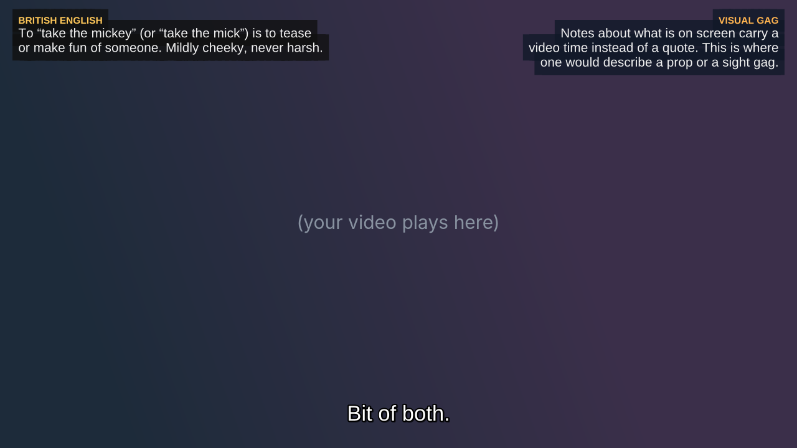

# Context Notes

Pop-up explanations for shows and films: idioms, slang, cultural references, historical context, wordplay, delivery, and sight gags that are easy to miss if you didn't grow up where the show was made.

Notes appear as small boxed overlays while you watch, in VLC (or any player that handles ASS subtitles). Dialogue stays at the bottom; notes about what is *said* pop up top-left just after the line, and notes about what is *on screen* pop up top-right.



> **Status: alpha.** It works end to end, but it is young, tested mostly on English-language British comedy, and the notes are written by an AI. Expect rough edges, and expect the occasional wrong note (see [Limitations](#limitations)).

## Why

- **Watching in a second language.** Idioms, local customs, historic figures and in-jokes get lost when you don't have the background.
- **Archaic language.** Shakespeare and friends: what a word meant then, and which jokes are bawdy.
- **Teaching.** Makes older or foreign material more approachable without a course in front of it.

## How it works

```
 episode.mp4 / episode.srt
        │
        ▼
 analyze.py        transcript, subtitle sync check, loud moments, contact sheets
        │          (optional --align re-times subtitles from another release)
        ▼
 notes JSON        one small file of notes, written by hand or by Claude
        │          make_ass.py --generate   (from the dialogue)
        │          make_ass.py --refine     (re-checked against the video's frames and soundtrack)
        ▼
 make_ass.py       merges subtitles + notes into  <video>.notes.ass
        │
        ▼
 VLC               loads the .notes.ass next to the video; the extension in vlc/ adds topic checkboxes
```

| File | What it does |
|---|---|
| `app.py` | The same workflow in your web browser, for anyone who'd rather not use Terminal: `python3 app.py`. The page is kept in parts in `gui/src` (see `gui/README.md`), joined on each request. |
| `context_notes.py` | **Start here** in Terminal. Runs the whole workflow for one video or a folder: finds the subtitles, checks sync (offers `--align` if needed), `--generate`, `--refine`, builds the `.ass`. Skips steps already done. |
| `analyze.py` | Prepares an episode: numbered transcript, pulls embedded subtitles out of an MP4/MKV, checks whether an SRT matches the video, finds loud moments with no dialogue, builds contact sheets, optionally re-aligns subtitles. |
| `make_ass.py` | Merges an SRT and a notes file into one `.ass`. Also the front door for `--generate` and `--refine`. |
| `generate_notes.py` | Has Claude write a first notes file from the dialogue. (Used through `make_ass.py`.) |
| `refine_notes.py` | Has Claude look at frames and loud moments to add visual/delivery notes, fix and retime existing ones. (Used through `make_ass.py`.) |
| `vlc/context_notes.lua` | VLC extension: loads the `.notes.ass` automatically and lets you switch note topics on and off. |
| `align_check.py` | Checks every note against the speech in the seconds before it; reports stretches that are out and can fix them. |
| `find_subs.py` | Finds subtitles for a video that has none beside it: `Subs/` folders, OpenSubtitles.com, or speech recognition. |
| `dedupe.py` | Lists notes that explain something an earlier note already did (the build leaves those out). |
| `chat_notes.py` | Write the dialogue notes in a claude.ai chat or with Claude Code (your subscription) instead of the API. |
| `languages.py` | Language codes and names shared by the scripts (`fr`, `fre`, `French` are all French). |
| `tidy.py` | Moves the working files earlier versions left beside your videos into their `context-notes` folders (see [Where the files go](#where-the-files-go)). |
| `embed.py` | Puts a film's notes inside the `.mkv` as a subtitle track, for films that already have a `.notes.ass` (see [Putting the notes inside the film](#putting-the-notes-inside-the-film)). |
| `workfiles.py` | Where each script puts a video's working files, and finds them again. |
| `prompts.py` | How the scripts ask questions: in Terminal as usual, or answered by another program such as a GUI ([docs/gui-protocol.md](docs/gui-protocol.md)). |

The shared code the scripts above are built from (none of these are run on their own):

| File | What it holds |
|---|---|
| `claude_api.py` | The Claude API: the key, sending a request (with retries), prices and image sizes. |
| `claude_code.py` | Your Claude plan: one request through Claude Code in the background (`claude -p`), with no API key and no tools beyond reading the contact sheets. Also whether Claude Code is installed and signed in. |
| `sending.py` | What `--generate` and `--refine` share: the plan or the API for each request (and moving to API credits when the plan runs out, if allowed), the estimate, the question before sending, and sending the parts one at a time while keeping what was written if a run stops. |
| `cli_common.py` | The options `context_notes.py` and `make_ass.py` share (the model, effort, `--limit`, and how the notes look), defined once, and the code that passes them from one script to the next. |
| `settings.py` | This install's defaults (the Settings page writes them; every script reads them). |
| `usage.py` | The ledger of what each request cost, the credit estimate and the session meter. |
| `subtitles.py` | Reading and writing `.srt` files, and finding a note's quoted words in them. |
| `timecode.py` | Times: `1:02:03,500`, `5:00`, `5m` and the like, read and written. |
| `fileio.py` | Writing files all at once (so a stop never leaves half a file), backups, and the config folder. |

## Requirements

- Python 3.9 or newer
- `ffmpeg` and `ffprobe` for anything that touches a video (`brew install ffmpeg`, `apt install ffmpeg`, or [ffmpeg.org](https://ffmpeg.org/download.html))
- `pip install -r requirements.txt` (one step: numpy and Pillow for the video checks, faster-whisper for speech recognition, and pytest and ruff for development. faster-whisper is a large download; skip it with `pip install numpy Pillow` if you won't use speech recognition)
- Only if you want Claude to write or refine notes: [Claude Code](https://claude.com/claude-code) signed in with a
  Claude Pro or Max plan (the default; no API credits), or an Anthropic API key

Writing notes by hand and building the `.ass` needs nothing beyond Python.

## Quick start

```bash
git clone https://github.com/alt229/context-notes.git
cd context-notes
python3 -m venv .venv && source .venv/bin/activate
pip install -r requirements.txt

# Try the bundled example (no API key, no video needed)
python3 make_ass.py examples/help-desk/the-help-desk.srt examples/help-desk/notes-the-help-desk.json -o /tmp/demo.ass
```

On Windows, see [Windows](#windows) for the same steps in PowerShell.

Then with your own episodes (put your own files wherever you like; nothing in this repository needs them to live in it):

```bash
# One-time: sign Claude Code in with your Claude account (notes are written on your plan by default)
claude
# ...or, to use API credits instead (--route api, or Settings in the app), save your API key
# (stored in ~/.config/context-notes/api-key, mode 600)
python3 make_ass.py --set-api-key

# Everything, for one episode or a whole season folder
python3 context_notes.py "/Volumes/Media/TV Shows/IT Crowd/Season 1"
python3 context_notes.py "S01E03 Fifty Fifty.mp4"
python3 context_notes.py "Season 1" --status          # what's done and what's left; runs nothing
python3 context_notes.py film.mkv --limit 5:00        # try the first 5 minutes of a long film
```

`context_notes.py` prints every command before it runs it, so you can see (and rerun) each step. It asks before anything is sent to Claude (the scripts' own prompts, with the cost on API credits), and only asks you a question when there's a real choice, such as subtitles that drift. `--yes` takes the default answer everywhere, for unattended runs. Rerunning it skips whatever is already done.

The same steps by hand:

```bash
# 1. Is the SRT in sync? (local, free)  --frames none skips the contact sheets, which --refine makes anyway
python3 analyze.py episode.srt --video episode.mp4 --frames none

# 2. Have Claude write a first set of notes from the subtitles (shows a cost estimate and asks first)
python3 make_ass.py episode.srt --generate --video episode.mp4 --title "Show - S01E01 - Title"

# 3. Optional: make it better by letting Claude look at the video
python3 make_ass.py episode.srt --refine --video episode.mp4

# 4. Play episode.mp4 in VLC. episode.notes.ass sits next to it.
```

Your video has subtitles inside it? Skip the SRT: `python3 analyze.py episode.mp4` extracts them (`--list-tracks`, `--sub-track N`, `--strip-sdh` are there if you need them).

## Windows

Everything runs on Windows itself; WSL isn't needed. In PowerShell:

```powershell
winget install Python.Python.3.13 Gyan.FFmpeg VideoLAN.VLC Git.Git
# then open a new PowerShell window, so it finds them
git clone https://github.com/alt229/context-notes.git
cd context-notes
python -m venv .venv
.venv\Scripts\Activate.ps1          # if PowerShell refuses: Set-ExecutionPolicy -Scope CurrentUser RemoteSigned
pip install -r requirements.txt
python app.py
```

- The commands in this README say `python3`, as on macOS and Linux. On Windows, type `python`.
- Your API key is kept in `C:\Users\<you>\.config\context-notes\api-key`.
- Network drives and shares (`Y:\Movies`, `\\nas\Movies`) work as they are.
- The VLC extension goes in `%APPDATA%\vlc\lua\extensions\`, and the app's Settings can put it there.
- Windows support is new, and so far less tried than macOS.

## The app, in your browser

Prefer buttons to Terminal? Start the app, and it opens a page in your browser:

```bash
python3 app.py
```

- **Choose** a film or a folder of episodes. The list shows what's already done for each video.
- **Pick how the notes are written:** best (Claude Opus) or cheaper (Claude Sonnet), whether Claude also looks at the
  frames, and how much of the film. More options has the rest: subtitles in another language, who the notes are for
  (the default is fluent in American English), how hard the model thinks, and whether to search online for subtitles.
- **On screen:** how long notes stay up, in seconds a word (empty keeps each film's own, 0.4 unless you changed it),
  and what's behind them: a see-through box (and how solid it is, 30% unless you change it), the dark box from
  before, or no box with outlined text. Changing these for a film that's already done is free: the list says "Needs
  a rebuild", and the button becomes "Rebuild (free)".
- **Write the notes.** The cost appears on screen before anything is sent, along with any other question (picking up
  a stopped run, for example). It's sent after 10 seconds unless you press Wait or Don't send, so a whole season can
  run on its own; untick "Send 10 seconds after showing the cost" to always decide yourself. Progress is shown as it
  goes, and Cancel stops it the way Ctrl-C does.
- **Tidy up.** Films that an earlier version worked on may still have their working files beside the video. The page
  says so, and Tidy lists what would move into the `context-notes` folder, then moves it when you say (see
  [Where the files go](#where-the-files-go)).
- **Change or delete…** holds the two actions that remove or rewrite files, each with its own Go button: deleting
  the kept originals (a dry run lists them with their sizes first), and writing the notes again (the notes they
  replace are kept as `.bak`).
- **Watch:** open a finished video in VLC from the list.
- **Credit and session.** Two small meters sit beside Settings. **API credit** is about how much of your prepaid
  credit is left; it counts down as notes are written and turns red below your warning level. **Plan session**
  appears when you use a Claude Pro or Max plan through Claude Code, and shows how much of the 5-hour session is
  used and when it resets (see [Credit and session use](#credit-and-session-use)). The cost question also says how
  much credit you have left, and warns if the run may cost more.
- **Settings** starts with **Claude**: where the notes are written (your Claude plan through Claude Code, the default,
  or API credits), whether Claude Code is installed and signed in, and "Use API credits when the plan runs out, up to
  $___ a run" (see [Your Claude plan or API credits](#your-claude-plan-or-api-credits)). The same choice sits beside
  the run options for one run. Then your Anthropic API key (saved in the usual place), the credit you have left, the
  OpenSubtitles login, and a button that installs the VLC extension.
- **Defaults for every run** (in Settings): the model, thinking effort, who the notes are for, the language to write
  them in, seconds a word, the box and how solid it is, frames, the timing check, online subtitle search (and whether
  to download what it finds without asking), subfolders, Yes to all questions, and the starting folder. They're saved
  on this computer, and the Terminal scripts read them too, so both start from
  the same choices. A film that already has notes keeps its own look and audience. Subtitle choices and anything that
  rewrites or deletes files stay per run. Send-after-10-seconds is on by default: notes go to Claude after 10 seconds
  unless you press Don't send. (It never answers the question about moving to API credits.) Untick it in Settings to be asked each time instead.
- **Yes to all questions** (in Settings, off by default; `context_notes.py --yes-to-all` for one run): a run doesn't
  stop to ask about the work. It downloads subtitles, writes them from the soundtrack when none are found (slow),
  checks new notes' timing against the speech and fixes the stretches that are out, re-times subtitles that drift,
  picks up a run that stopped, and goes on to the next video. Each answer is in the log. It never answers sending to
  Claude (that's Send-after-10-seconds, or `--yes`), using API credits (that's "Use API credits when the plan runs
  out"), or deleting anything. Unlike `--yes`, which takes each question's default, it says yes even where the
  default is no (writing subtitles from the soundtrack) and even when nobody is there (the timing check).

Keep the Terminal window open while you use it; Ctrl-C there stops it. It runs the same scripts described below, so
anything it does you can also do by hand. Only your computer can reach it: it listens on 127.0.0.1, and the page's
address (printed when it starts) carries a random key.

**From your phone or another computer at home:** `python3 app.py --hosted`. It then answers devices on your own
network (private addresses only: home Wi-Fi, Tailscale and the like; `--allow 10.8.0.0/24` adds a range such as a
WireGuard subnet), on a fixed port (8229) with a key that's kept between starts, so a bookmark keeps working
(`--new-key` makes a new one). It prints the address to use from another device. From there you can choose films
(with "Browse here"), write notes, rebuild, embed and tidy, and change Settings. Opening a film in VLC, Show in
folder, the file dialogs, installing the VLC extension, deleting kept originals and saving the API key or the
OpenSubtitles login only work in a browser on the computer running the app (they would act on that computer's
desktop, can't be undone, or would send a key across your network unencrypted). Settings offers the VLC extension as
a download for the computer you watch on. `--public` is only for a server behind your own HTTPS proxy: it answers
any address, and the key is all that guards it.

On Windows, run it in PowerShell (see [Windows](#windows)); network drives such as `Y:\Movies` and `\\nas\Movies`
work as they are. It also runs inside WSL, but there a network drive has to be mounted first
(`sudo mkdir -p /mnt/y && sudo mount -t drvfs Y: /mnt/y`), and reading from it is slower.

## Using it

### Where the files go

Beside each video stays only what players use: `<video>.notes.ass` for VLC, its Plex copy `<video>.en.ass`, and real
subtitles (yours, or ones `find_subs.py` found or downloaded). Everything else goes in one `context-notes` folder
beside the videos, with a folder for each video:

```
Parasite.mkv
Parasite.notes.ass
Parasite.en.ass
Parasite.en.srt
context-notes/
    Parasite.mkv/
        notes-Parasite.json          the notes, with their .bak backups, refine report and pick-up files
        Parasite.embedded.en.srt     subtitles pulled out of the video, re-timed (.aligned) or written by
                                     speech recognition (.transcribed)
        Parasite.en.transcript.txt   the numbered transcript
        analysis/                    sync report, contact sheets, soundtrack and speech-recognition caches
```

The `context-notes` folder also gets `.plexignore`, `.ignore` and `.embyignore` files, which tell Plex, Jellyfin and
Emby to skip it when they scan your library (there are no videos in it, only notes and thousands of frames). One
that's already there is left alone.

Earlier versions left these files beside the video, with the analysis in `<video> analysis/`. A film like that
carries on exactly as before, and `context_notes.py --status` points it out. `tidy.py` moves its files in:

```bash
tidy.py "/Volumes/Movies" --recursive --dry-run   # list what would move, and move nothing
tidy.py "/Volumes/Movies" --recursive             # move it (it asks first; --yes doesn't)
tidy.py film.mkv                                  # one video
```

### Putting the notes inside the film

`<video>.notes.ass` beside the video is all VLC needs. To have the notes travel with the film itself (one file to
copy or share, or a device that doesn't read subtitle files beside a video), `embed.py` adds them to an `.mkv` as
one more subtitle track, called "Context Notes". Nothing is re-encoded, so it costs nothing and keeps the notes'
colours, positions and fades.

```bash
python3 context_notes.py "film.mkv" --embed          # after the notes are written (or already done)
python3 embed.py "film.mkv"                          # a film that already has a .notes.ass
python3 embed.py "film.mp4" --convert                # an .mp4: make an .mkv first (the .mp4 goes to context-notes/originals)
python3 embed.py "/Volumes/Movies" --recursive       # every .mkv with a .notes.ass under a folder
python3 embed.py "/Volumes/Movies" --dry-run         # only list what it would do
python3 embed.py film.mkv --default                  # play with the notes on (otherwise: pick the track)
python3 embed.py "/Volumes/Movies" --delete-backups  # free the space the kept originals take
```

- It builds a new file in the film's `context-notes` folder, checks it (same length, same tracks, chapters and
  fonts, plus the new one), then swaps it in. Your original stays there as `<film>.original.mkv` until you delete
  it. It needs about the film's size in free space while it works.
- Existing subtitle tracks, chapters and fonts are kept. If the notes change later (a rebuild, or a new
  `--reading-speed`), run it again: it replaces its own track and never adds a second.
- `.mp4` files are left as they are unless you add `--convert`: MP4 can't hold these subtitles without losing their
  styling, so `--convert` rewrites the film as an `.mkv` first. The `.mp4` is kept in `context-notes/originals/`, the
  film's name changes, and its `mov_text` subtitles become SRT. Media servers may list it as a new film. A phone's or
  camera's timecode track (a data track an MKV can't hold) is left out, and the run says so. Notes that only cover the
  first part of a film (`--limit`) aren't embedded.
- Each run states the time it takes (a rough range from this NAS's read and write speed), the space it needs, and the
  copy it keeps. No Claude or API calls are made. The app's Embed dialog lists only films whose notes are not yet inside.

Files are moved as they are, never changed or overwritten. A file whose name is already taken in the folder, or that
could belong to two videos (`film.mkv` and `film.mp4`), stays where it is and is listed.

### `context_notes.py`

```bash
context_notes.py PATH                          # a video, or a folder of videos (--recursive for subfolders)
context_notes.py PATH --status                 # done / to do, per video
context_notes.py PATH --limit 5:00             # first 5 minutes only (also 300, 5m, 1:30:00)
context_notes.py PATH --film-language fr       # see "Films not in English" below
context_notes.py PATH --show "The IT Crowd"    # name used in the titles Claude sees (default: from the folders)
context_notes.py PATH --no-refine              # skip the video-frames step
context_notes.py PATH --redo                   # write the notes again (the old file is kept as .bak)
context_notes.py PATH --yes                    # don't stop to ask anything
context_notes.py PATH --yes-to-all             # yes to the questions about the work; sending still asks
context_notes.py PATH --reading-speed 120      # notes stay up longer (0.5 s a word); free for finished videos
context_notes.py PATH --note-background none   # no box behind the notes (also: dark, see-through, the default)
context_notes.py PATH --note-opacity 50        # a more solid see-through box (0 invisible, 100 solid; default 30)
```

What it decides for you:

- **Which subtitles.** `<video>.srt`, `<video>.en.srt`, `<video>.English.srt` and so on beside the video; a re-timed `<video>.aligned.srt` (in its `context-notes` folder) if one was made; otherwise the text track inside the video.
- **Sync.** If the subtitles are early or late by a constant amount, the offset goes into the notes file. If the timing drifts (a different cut or release), it offers to re-time them with `analyze.py --align`, carry on, or skip.
- **Title.** `IT Crowd/Season 1/S01E03 Fifty Fifty.mp4` becomes "IT Crowd - S01E03 Fifty Fifty", so the title always matches the file.
- **What's left.** Notes written? Refined? `.ass` older than the notes, or built with a different look? Notes made with `--limit` when you now want the whole thing? It runs only what's missing. When only the `.ass` is behind, it's rebuilt for free; nothing is sent to Claude and no API key is needed.

### Testing on part of a film: `--limit`

`--limit 5:00` works on `context_notes.py`, `analyze.py` and `make_ass.py --generate/--refine`. Only the first five minutes of dialogue are sent to Claude, and the soundtrack check, frames and `--align` speech recognition stop at five minutes too, so a test costs a few cents and a minute or two. The notes file records the limit; a later full run notices and offers to add the rest. Adding to them keeps the notes you have and sends only the lines after the limit, and the frames step then looks at only the rest of the video; or start again, which sends everything (the old file is kept as `.bak`). By hand: `make_ass.py film.srt --generate --extend`. A limited `--align` writes `<name>.aligned.first300s.srt`, so it is never mistaken for a full alignment.

### Films not in English

```bash
context_notes.py "Amélie.mkv"                        # audio tagged French? it notices. Otherwise:
context_notes.py "Amélie.mkv" --film-language fr
make_ass.py film.en.srt --generate --film-language fr --original-subs film.fr.srt     # by hand
```

By default you watch with the film's **own-language subtitles** (`film.fr.srt`, or the French track inside the video) and the notes, written in English, explain only what a good non-native reader would miss: idioms and set phrases, false friends, slang and regional speech, **register** (tu/vous, du/Sie, tú/usted and what a switch means), how strong an insult really is, references any native viewer would get, and untranslated text on screen. Notes quote the French exactly (so they attach to the right line) and explain it in English; whole lines are never translated. New categories: `Translation`, `Register`, `Slang`, `Dialect`, `On-screen text`.

**Notes from the French, English subtitles on screen:** add `--show-subs en`. The notes stay exactly where they were found in the French; only the subtitles at the bottom change, so if the notes already exist this just rebuilds the `.notes.ass` (no API cost). The choice is remembered in the notes file, and `--show-subs fr` switches back. Before using the English file it's compared with the corrected French subtitles and shifted if needed. By hand: `make_ass.py film.fr.srt notes.json --video film.mkv --display-subs film.en.srt`.

The notes themselves are in English; `--notes-language Spanish` (or any language) writes them in another.

Want Claude to work *from* the English subtitles instead? `--subs-language en` uses `film.en.srt` and also gives Claude the French lines alongside, so it can point out what the translation loses.

### Subtitles that are early or late

```bash
analyze.py film.fr.srt --video film.mkv --shift auto     # measure against the soundtrack, write film.fr.aligned.srt
analyze.py film.fr.srt --shift -2.5                      # you know the offset: every line 2.5 s earlier
analyze.py film.fr.srt --video film.mkv --shift -2.5     # ...and check the result against the video
```

The corrected copy is `<name>.aligned.srt`, in the video's `context-notes` folder; your original is never changed, and `context_notes.py` picks the corrected copy up automatically (it also runs `--shift auto` itself when it finds a constant offset). If the offset changes through the film (a different cut), a single shift can't fix it: use `--align`.

`analyze.py --align --film-language fr` re-times French subtitles with French speech recognition (multilingual `small` model by default). Re-timing only works for subtitles in the language being spoken, so English subtitles for a French film can't be re-timed this way; look for a set made for your release.

### `make_ass.py`

```bash
make_ass.py episode.srt                        # first run: creates a blank notes file to fill in
make_ass.py episode.srt notes.json --video episode.mp4     # -> episode.notes.ass
                                                            #    and episode.en.ass, the same file named so Plex lists it as
                                                            #    'English (ASS)' instead of 'Unknown' (--no-plex-copy: skip)
                                                            #    UNFINISHED: on IT Crowd S2/S3 this doesn't work yet in Plex
make_ass.py episode.srt notes.json --layout stack          # notes in one column instead of split left/right
make_ass.py episode.srt notes.json --note-background none  # what's behind the notes: see-through (default), dark, none
make_ass.py episode.srt notes.json --note-opacity 50       # how solid the see-through box is, 0 to 100 (default 30)
make_ass.py episode.srt notes.json --report                # how crowded each layout would be
make_ass.py episode.srt --generate [--title ... --audience ... --notes-language ...]
make_ass.py episode.srt --refine --video episode.mp4 [--frames dense] [--assume-synced]
make_ass.py episode.srt --generate --limit 5:00                # first 5 minutes only
make_ass.py episode.srt --generate --estimate-only             # size and cost only: nothing sent, nothing written
make_ass.py episode.srt --generate --extend                    # notes made with --limit: keep them, write the rest
make_ass.py film.en.srt --generate --film-language fr --original-subs film.fr.srt
make_ass.py --set-api-key
```

`--generate --offset 0.88` also records the offset in the notes file, so later rebuilds line up without it.

`--generate` and `--refine` print a size and cost estimate and ask before anything is sent (`--yes` skips the question). `--estimate-only` prints the estimate and stops. Nothing is sent, no API key is needed, and no notes or `.ass` are written (`--refine` still analyses the video and keeps that for the real run). Both keep backups: the old notes file as `.bak`, and `--refine` also keeps the previous `.ass` and writes a plain-text report of every change.

`--refine` checks the subtitle sync first. If it cannot measure one constant offset (subtitles from a different cut, say), it falls back to *visual-only* notes rather than guessing. Fix the subtitles with `analyze.py --align` and pass the aligned SRT, or use `--assume-synced` if you know they are right. It also refuses to run if the file names suggest the video is a different episode from the notes.

### `analyze.py`

```bash
analyze.py episode.srt                         # numbered transcript
analyze.py episode.mp4                         # extract embedded subtitles + transcript
analyze.py episode.srt --video episode.mp4     # sync check, loud moments, contact sheets
analyze.py episode.srt --video episode.mp4 --align   # re-time subtitles to this video (faster-whisper)
analyze.py episode.srt --video episode.mp4 --frames none   # sync check only (fast)
analyze.py film.mkv --sub-lang fr              # extract the French track -> film.embedded.fr.srt
analyze.py film.fr.srt --video film.mkv --align --film-language fr --limit 5:00
```

The soundtrack measurement is cached in the video's `analysis` folder (`context-notes/<video>/analysis/`), so `--refine` after a sync check doesn't decode the audio a second time.

### No subtitles?

`context_notes.py` looks further when there is no `.srt` beside the video and no text track inside it (or run
`find_subs.py film.mkv --lang de` yourself): a `Subs/` or `Subtitles/` folder (`Subs/2_English.srt`,
`Subs/<film>/English.srt`), and `.srt` files beside it named for the same film but not exactly like it. Then
OpenSubtitles.com, once you've saved a free login with `find_subs.py --set-opensubtitles` (stored in
`~/.config/context-notes/opensubtitles.json`, mode 600); a file uploaded for your exact release comes first, since
its timing will match. Last, it offers to write subtitles from the soundtrack with speech recognition
(`<film>.<lang>.transcribed.srt`, in the video's `context-notes` folder). Whatever it finds is copied beside the
video, where your player finds it too; nothing is moved.

### Repeated notes

A film's notes are written in parts, so the same idiom or person can get explained twice. `make_ass.py` leaves a
note out of the `.ass` when an earlier one already explained the same thing, and lists what it left out. The notes
file isn't changed: `--keep-duplicates` builds with everything, `"keep": true` keeps one note, and
`python3 dedupe.py notes.json` shows the repeats and near-misses. Running gags, setups and payoffs are never treated
as repeats. `--refine` works through the video a few minutes at a time, and each stretch is told what earlier notes
already explain, so it doesn't explain them again.

### How long notes stay up

Each note gets 2 s to be noticed plus its words at 0.4 s a word (150 a minute), between 6 and 24 s. A note that appears while earlier notes are still up stays longer, by half of each earlier note's time (never more than 45 s). `make_ass.py ... --timing-report`
shows how many seconds a word each note gets, which ones the 24 s ceiling cuts short, and how fast the film's own
subtitles go for comparison. Change it per film with `--reading-speed 180`, `--note-max 30`, `--note-min`,
`--note-settle`; the values are remembered in the notes file, so later rebuilds keep them.

### What's behind the notes

`--note-background` (on `make_ass.py` and `context_notes.py`, and "Behind the notes" in the app) picks the box:
`see-through` (the default), `dark` (the look before 0.2.0, about 80% solid) or `none` (no box; the text gets a
thin dark outline and a soft shadow, like the dialogue). `--note-opacity` ("How solid the box is" in the app) sets
the see-through box from 0 (invisible) to 100 (solid); the default is 30. Both are remembered in the notes file, as
`note_background` and `note_opacity`. A faint box can make light text harder to read over bright scenes; raise it a
little if so.
Each `.ass` records how it was built in a `; Look:` line at the top, and `context_notes.py` rebuilds a finished
video's `.ass` when that line is missing or differs from what you asked for. So the first run after updating rebuilds
each finished video once, for free. Options given only to `make_ass.py` by hand (`--layout stack`,
`--keep-duplicates`) aren't remembered; give them again if you used them.

Before a rebuild the app shows what will change: the box, the opacity and the speed now and after, the subtitles,
and the files written (`context_notes.py --preview-rebuild` gives the same list in Terminal). Every rebuild keeps the
`.notes.ass` it replaces as `<name>.notes.ass.bak`, then `.bak2` and so on, so an older look can always be found
again. The same dialog can also put the new notes inside the `.mkv` afterwards.

### Checking every note's timing

```bash
context_notes.py film.mkv --check-alignment                 # also works on a film that's already done
align_check.py film.mkv film.de.srt                         # by hand; the film's notes file is found for you
align_check.py film.mkv film.en.srt --original-subs film.de.srt --film-language de
align_check.py film.mkv film.de.srt --fix                   # -> film.de.aligned.srt, stretches that were out moved
```

The sync check fixes one offset for the whole film. This goes note by note: it finds the words of the lines in the
10 s before each note (`--window 5` for less) in a speech-recognition transcript of the soundtrack, and reports the
stretches where those lines are more than 0.7 s early or late. English subtitles on a German film are measured
through the German ones. The transcript is made once (slow: very roughly a tenth of the running time) and shared with
`analyze.py --align`. The note-by-note table is in `context-notes/<video>/analysis/alignment.txt`.

### Notes file format

A notes file is JSON: a title, an audience, and a list of notes. A note attaches to a line by quoting it, so the same notes survive a different release of the episode. Full reference, including visual notes, timing options and categories, in [docs/notes-format.md](docs/notes-format.md). A small example:

```json
{
  "title": "Show - S01E01",
  "audience": "Fluent in American English",
  "notes": [
    {"match": "taking the mickey", "category": "British English",
     "text": "To “take the mickey” is to tease someone. Mildly cheeky, never harsh."},
    {"at_video": "00:14:33,000", "kind": "visual", "category": "Visual gag",
     "text": "The sign behind him reads ..."}
  ]
}
```

## Using it with Claude Code

This folder is also a Claude Code project. Run `claude` in it and:

- `/notes "<film>.mkv"`: Claude Code writes the dialogue notes itself, in the conversation, on your Claude plan. A
  note-writer agent (Opus) takes the film one part at a time; the result goes through `chat_notes.py collect`, then
  the `.ass` is built and checked for repeats and timing. (`context_notes.py` and the app also use your plan by
  default, through Claude Code in the background; `/notes` is for watching it work part by part.)
- `/refine "<film>.mkv"`: the frames step the same way, one stretch of the video at a time. A frame-reviewer agent
  (Opus) opens each contact sheet, adds notes about what's on screen and fixes the dialogue notes the frames show to
  be wrong; `chat_notes.py collect-frames` then applies its replies exactly as `--refine` would (backups, a report of
  every change, and it picks up where it stopped). Handy for trying settings on a show as you go.
- `/check "<film>.mkv"`: subtitles found and synced, every note's timing checked, fixes offered.

`CLAUDE.md` holds what the project has learned so far (benchmark results, defaults, pitfalls). The agents are in
`.claude/agents/`; edit the `model:` line to change which Claude each one uses.

## Running it from another program

`app.py` is one such program. A program that starts the scripts with the
environment variable `CONTEXT_NOTES_UI=json` gets every question, hidden prompt, cost estimate and progress report as
a line of JSON on stdout, and answers on stdin. It cancels a run the way Ctrl-C does. Without that variable, nothing
changes. Details and the list of questions are in [docs/gui-protocol.md](docs/gui-protocol.md).

Stopping part-way, with Ctrl-C, a GUI's Cancel or an API error, is safe. The notes Claude has already written, and
a refine's changes so far, are kept. So is everything up to the last finished request when a run ends with no
warning at all (the window closed, the computer lost power): what's done is saved after every request. The next run
asks whether to pick up where it left off; that's the default, so nothing you've paid for is sent twice. No file is
ever left half-written.

## VLC extension

Copy `vlc/context_notes.lua` into VLC's extensions folder, restart VLC, then choose **VLC → Extensions → Context Notes**.

| OS | Folder |
|---|---|
| macOS | `~/Library/Application Support/org.videolan.vlc/lua/extensions/` |
| Linux | `~/.local/share/vlc/lua/extensions/` |
| Windows | `%APPDATA%\vlc\lua\extensions\` |

The extension looks for `<video name>.notes.ass` beside the video and gives you checkboxes for each kind of note. It has mainly been tried on macOS; reports from other systems are welcome. The `.notes.ass` file also works in any player without the extension, with every note shown.

## Your Claude plan or API credits

**The plan (the default).** With a Claude Pro or Max plan, the notes are written through
[Claude Code](https://claude.com/claude-code) in the background, one request per part (`claude -p`), with no API
credits. Install Claude Code and sign in once by running `claude` in Terminal. Each request is kept small and
closed off:

- It can't use an API key: `ANTHROPIC_API_KEY` (and the other ways of signing in) are taken out of what it sees, so it
  only ever uses your Claude account. If Claude Code is signed in with an API key, it isn't used at all.
- The dialogue notes get no tools. The frames step gets only Read, for the folder of contact sheets, and opens each
  sheet itself.
- It runs in the notes' folder with Claude Code's extras off (`--safe-mode`: no CLAUDE.md, hooks, MCP servers or
  plugins), and keeps no session.
- Each request also carries about 15,000 tokens of Claude Code's own (mostly cached) context, so a short part costs
  the plan more than its text alone would.

**When the plan can't go on**: the 5-hour session is at 90% (when Claude Code's status line has given a reading; see
below), the plan's limit is reached, or Claude Code isn't installed or signed in.

- If API credits are allowed for the run, it carries on with them, up to that much for the whole run (every film
  and step in it): `--api-fallback 5`, or "Use API credits when the plan runs out, up to $5 a run" in the app's
  Settings (and beside the run options, for one run).
- Otherwise it asks (in Terminal, or in the app) whether to carry on with API credits, saying what the rest would
  cost and how much credit is left. With `--yes`, or when nobody can be asked, it stops instead. Either way what was
  written is kept, and running the same command again picks up where it stopped.

**API credits from the start**: `--route api`, or "API credits" in Settings. API usage is billed to your Anthropic
account, separately from a Claude plan.

- See [Credit and session use](#credit-and-session-use) for a running total and an estimate of the credit left.
- The key is read from `--api-key-file`, then `~/.config/context-notes/api-key` (or `$XDG_CONFIG_HOME/context-notes/api-key`), then the `ANTHROPIC_API_KEY` environment variable as a fallback. The file must be readable only by you; `--set-api-key` creates it that way.
- Rough costs at the list price of the default model (Opus): writing notes (`--generate`) is a few cents to about
  10 cents an episode; `--refine`, which sends images, about 20 to 50 cents. Sonnet ("Cheaper") is about half. The
  tool shows an estimate and asks before sending. Prices change; check [Anthropic's pricing page](https://platform.claude.com/docs/en/about-claude/pricing).

## Credit and session use

`usage.py` keeps two meters, because the two kinds of use work differently.

**API credit.** Anthropic gives programs no way to ask "how much credit is left?", so this is an estimate: tell it
what Billing in the Anthropic console shows once, and it subtracts what this tool's own requests cost from then on.

```
python3 usage.py --set-balance 25.00        # once, and again after you top up (or to correct drift)
python3 usage.py --add-credit 20            # or just say how much you added
python3 usage.py                            # credit left, spending today / this month, the latest films, the session
```

- During a run, each request prints one line: `$0.03 (run $0.11, film $0.42) · about $17.82 left`. The plan line before
  the cost question says what's left and warns if the run may outspend it. When the film has had more than one step,
  the last line adds what the film has cost in all.
- Warns when the estimate drops below $2 (`--set-balance 25 --low 3` changes that).
- If the API itself says the credit has run out, the estimate is set to $0 at once and the message says where to add
  credit. Rerun the same command afterwards: what was written is kept and only the rest is sent.
- It leaves out anything else spent on the same account (other tools, other keys), so it drifts. Type the console's
  figure in again when it matters.
- A model whose price isn't in `claude_api.PRICES` is counted as "unknown", not as free.
- Requests on your Claude plan are in the ledger too (with their tokens and no dollars), and are left out of the
  credit estimate. Each one prints its tokens and, when there's a reading, how much of the 5-hour session is used.
- **It stops before the credit runs out.** Before each request it checks the estimate against what a request has
  cost so far in this run (or the plan's estimate, for the first). If the next one would take it under $0, it asks
  "Carry on anyway / Stop here" (once per run). With `--yes`, or when nothing can ask, it stops. What was written is
  kept; add credit (`--add-credit`) and rerun to pick up where it left off. With no balance set, it never stops a run.
- The ledger (`usage.jsonl`), the balance (`credit.json`) and the session reading (`session.json`) are kept beside
  your API key in `~/.config/context-notes/`. Nothing in them is secret, and the key is never written to them.

**Claude plan session.** The 5-hour and 7-day usage windows of a Pro or Max plan, which the `/notes` command uses,
are not visible to the API at all. Claude Code reports them to its status line, and `.claude/statusline.py` saves
what it hears. To switch it on, make `.claude/settings.local.json` (this is yours alone; git ignores it):

```json
{ "statusLine": { "type": "command", "command": "python3 \"/path/to/context-notes/.claude/statusline.py\"" } }
```

Claude Code then shows `[Opus 4.5] 5h 42% (resets 8:10 PM) · 7d 18% · API ~$17.82`, `python3 usage.py --session`
prints the same reading in a sentence, and `/notes` repeats it after each part. Notes written on the plan in the
background bring a reading back with every request too (Claude Code reports the plan's windows with each answer), so
during those runs the meter and the 90% stop are current even with no Claude Code window open. In the app, clicking
the Plan meter gets a fresh reading at any time: one tiny request on your plan (Haiku, a word each way, plus Claude
Code's own context), no API credits. `python3 usage.py` also gives the
week: API spending over the last 7 days, the plan's 7-day figure, and how many 5-hour sessions the status line has
seen this week (and how full the busiest got); the app shows the same under Settings, "This week". The plan's
percentages cover everything on your plan, claude.ai chat included, but the session count only has the sessions the
status line was running for. The reading only moves while Claude
Code is open in this project; a window that has reset since the last reading is shown as reset, not as the old
percentage. This replaces any status line of your own for this project, and appears only with a Pro or Max plan,
after Claude's first reply.

**Pausing `/notes` and planning a film.** `/notes` does two more things with the session reading:

- Before each part it runs `python3 usage.py --session --stop-at 90`. At 90% or more of the 5-hour session it stops
  starting parts, says where it got to and when the session resets, and keeps the finished parts. Run `/notes` again
  after the reset. (`--stop-at` takes any percentage; a window that has already reset doesn't count.)
- It learns what a part costs. Around each part (or pair) it notes the session's percentage, and records how far it
  moved (`parts.jsonl`; a measurement is dropped if the window reset in between or the figure didn't move).
  Before a film it says, from the median of those, roughly how much of a session the film will take and how many
  parts should fit before 90% (`python3 usage.py --parts-estimate 12`). With nothing measured yet, it says so.

## Privacy

`--generate` sends the subtitle text to Claude (through Claude Code on your plan, or the Anthropic API). `--refine` also sends frames from your video as small JPEG contact sheets. Nothing is sent without the confirmation prompt (unless you pass `--yes`), and nothing else leaves your machine. The scripts use only the Python standard library for networking.

## Limitations

- **Notes are AI-written and can be wrong.** Medium- and low-confidence notes are marked "(less sure)". Treat them as a starting point, especially for historical claims, etymology and "who is this person" notes. Check anything you intend to rely on or teach.
- **Tuned for English-language material.** Foreign-language support (`--film-language`) is new and has been tested only on synthetic clips; expect the prompts to need tuning on real French, German and Spanish films. Non-Latin-script subtitles are untested.
- **Frame sampling is coarse.** A sight gag between sampled frames can be missed.
- **Alpha.** Interfaces and the notes format may change between releases; see the [changelog](CHANGELOG.md).

## Please don't commit media

Do not add video files, full subtitle files, or generated `.ass`/transcripts of commercial shows and films to a public repository. They are copyrighted. The `.gitignore` here excludes the usual suspects, and the bundled example uses an invented scene written for this project. Sharing *notes* files (which contain your own commentary plus short quoted match phrases) is a grey area; when in doubt, share the commentary and leave the dialogue out.

## Development

```bash
pip install -r requirements.txt
pytest          # no network, no API key, no real video needed (a fake API server and synthetic ffmpeg clips are used)
ruff check .
```

Each script keeps only its own job; the shared pieces are in the second table above. A change to how the Claude
options work, for example, is made once in `cli_common.py` and both `context_notes.py` and `make_ass.py` get it.
Old names still work (`make_ass.write_text_safely`, `generate_notes.call_api` and so on point at the new places), but
new code should use the new modules. Patch the module a function lives in, not an old name for it: a test or the
benchmark that replaces `generate_notes.call_api` would no longer stop real requests, so `bench/bench.py` replaces
`claude_api.call_api`.

See [CONTRIBUTING.md](CONTRIBUTING.md).

## License

[MIT](LICENSE).
